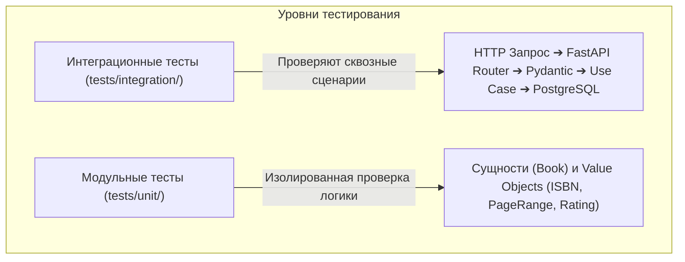

# HomeLibrary Manager — Тестовая документация

> **Комплекс модульных (Unit) и интеграционных (Integration) тестов бэкенда HomeLibrary Manager**.  
> Стек: **Python 3.11+**, **Pytest 8**, **pytest-asyncio**, **HTTPX (AsyncClient)**, **pytest-cov**, **SQLAlchemy (NullPool)**, **PostgreSQL**.

---

## 📌 Навигация

- [1. Концепция тестирования](#-1-концепция-тестирования)
- [2. Структура тестовой директории](#-2-структура-тестовой-директории)
- [3. Модульные тесты (Unit Tests)](#-3-модульные-тесты-unit-tests)
- [4. Интеграционные тесты (Integration Tests)](#-4-интеграционные-тесты-integration-tests)
- [5. Архитектура интеграции и conftest.py](#-5-архитектура-интеграции-и-conftestpy)
- [6. Сводная таблица тест-кейсов](#-6-сводная-таблица-тест-кейсов)
- [7. Инструкция по запуску](#-7-инструкция-по-запуску)

---

## 🎯 1. Концепция тестирования

В соответствии с принципами чистой архитектуры тестирование разделено на два изолированных уровня:



1. **Модульный уровень (Unit)**: тестирование бизнес-правил ядра без сторонних зависимостей (без СУБД, сети и HTTP). Выполняются моментально в оперативной памяти.
2. **Интеграционный уровень (Integration)**: сквозная проверка взаимодействия компонентов системы: валидация Pydantic-схем, корректность HTTP-статусов, выполнение Use Cases и транзакции в реальной базе данных PostgreSQL.

---

## 📁 2. Структура тестовой директории

```text
backend/tests/
├── README.md                          # Данная документация
├── unit/                              # Модульные тесты (чистая логика)
│   ├── __init__.py
│   └── test_domain.py                 # Проверка сущностей и Value Objects
└── integration/                       # Интеграционные тесты (API + База данных)
    ├── __init__.py
    ├── conftest.py                    # Фикстуры, подмена get_db и тестовый AsyncClient
    └── test_api_endpoints.py          # Тестирование HTTP эндпоинтов и сценариев
```

---

## 🧩 3. Модульные тесты (Unit Tests)

Файл: `tests/unit/test_domain.py`  
Фокусируется на инвариантах предметной области (**Domain-Driven Design**):

- **Валидация ISBN (`ISBN`)**:
  - Нормализация и очистка от дефисов и пробелов (`978-5-93286-060-1` ➔ `9785932860601`).
  - Вызов исключения `InvalidIsbnError` при неверной длине или недопустимых символах.
- **Диапазон страниц (`PageRange`)**:
  - Вызов исключения `InvalidPageRangeError`, если начальная страница больше конечной (`start_page > end_page`).
- **Рейтинг книги (`Rating`)**:
  - Вызов исключения `InvalidRatingError` при выходе оценки за пределы диапазона от 1 до 5.
- **Автоматический жизненный цикл книги (`Book`)**:
  - Инициализация со статусом `unread`.
  - Автоматический переход в `reading` при частичном прочтении страниц.
  - Автоматический переход в `read` при полном прочтении книги.

---

## 🌐 4. Интеграционные тесты (Integration Tests)

Файл: `tests/integration/test_api_endpoints.py`  
Все тесты построены по паттерну **AAA (Arrange — Act — Assert)**:

- **Позитивные сценарии (Happy Path)**:
  - `GET /api/v1/books` — проверка доступности каталога и возврата статуса `200 OK`.
  - `POST /api/v1/books/manual` — создание книги, сохранение в PostgreSQL и возврат `201 Created`.
  - Цепочка **Create ➔ Read**: создание книги через `POST` и успешное получение её по `id` через `GET`.
- **Негативные сценарии (Negative Path)**:
  - `GET /api/v1/books/0` — обработка несуществующего ресурса (`404 Not Found`).
  - `POST /api/v1/books/manual` с отрицательными страницами — перехват ошибки схемой Pydantic (`422 Unprocessable Entity`).
  - Повторное создание книги с тем же ISBN — проверка бизнес-правила уникальности (`409 Conflict`).

---

## ⚙️ 5. Архитектура интеграции и `conftest.py`

Файл `tests/integration/conftest.py` решает ключевые инженерные задачи интеграционного тестирования:

1. **Изоляция соединений PostgreSQL (`NullPool`)**:
   По умолчанию драйвер `asyncpg` кэширует пул соединений. В тестах каждый тест выполняется в отдельном цикле событий `asyncio`. Использование `NullPool` закрывает соединение сразу после завершения запроса, предотвращая блокировки транзакций и ошибку `InterfaceError: cannot rollback`.
2. **Бессерверный HTTP-клиент (`ASGITransport`)**:
   Тесты обращаются напрямую к экземпляру `app = FastAPI()` в памяти через `httpx.AsyncClient`. Это устраняет необходимость вручную запускать сервер `uvicorn` на реальном сетевом порту.
3. **Механизм Dependency Overrides**:
   Внедрение тестовой фабрики сессий в контейнер зависимостей FastAPI:
   ```python
   app.dependency_overrides[get_db] = get_db_connection
   ```

---

## 📋 6. Сводная таблица тест-кейсов

| ID | Название теста | Уровень | Метод и URI | Ожидаемый результат |
| :--- | :--- | :--- | :--- | :--- |
| **TC-U01** | `test_isbn_valid` | Unit | — | Корректная нормализация ISBN-13 |
| **TC-U02** | `test_isbn_invalid_error` | Unit | — | Возбуждение `InvalidIsbnError` |
| **TC-U03** | `test_page_range_negaive_raises_error` | Unit | — | Возбуждение `InvalidPageRangeError` |
| **TC-U04** | `test_rating_error` | Unit | — | Возбуждение `InvalidRatingError` (оценка > 5) |
| **TC-U05** | `test_book_auto_status` | Unit | — | Смена статуса: `unread` ➔ `reading` ➔ `read` |
| **TC-I01** | `test_get_book` | Integration | `GET /api/v1/books` | Статус `200 OK`, получение каталога |
| **TC-I02** | `test_add_book` | Integration | `POST /api/v1/books/manual` | Статус `201 Created`, запись книги в БД |
| **TC-I03** | `test_negative_get_book` | Integration | `GET /api/v1/books/0` | Статус `404 Not Found` |
| **TC-I04** | `test_negative_add_book` | Integration | `POST /api/v1/books/manual` | Статус `422 Unprocessable Entity` (валидация) |
| **TC-I05** | `test_negarive_duplicate_isbn` | Integration | `POST /api/v1/books/manual` | Статус `409 Conflict` (дублирование ISBN) |
| **TC-I06** | `test_add_book_crud` | Integration | `POST` ➔ `GET /{id}` | Статус `201` затем `200`, сверка полей книги |

---

## 🚀 7. Инструкция по запуску

Все команды выполняются из директории `backend` с активированным виртуальным окружением `venv`.

### 1. Запуск всех тестов проекта
```powershell
pytest
```

### 2. Подробный запуск всех тестов
```powershell
pytest -v
```

### 3. Запуск только модульных тестов
```powershell
pytest -v tests/unit/
```

### 4. Запуск только интеграционных тестов
```powershell
pytest -v tests/integration/
```

---
